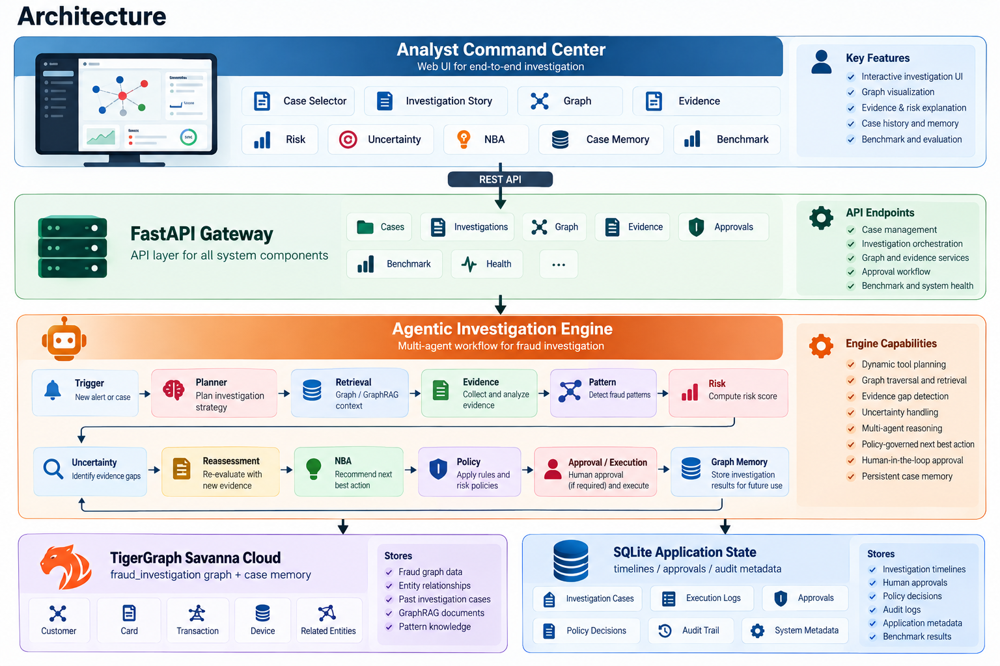
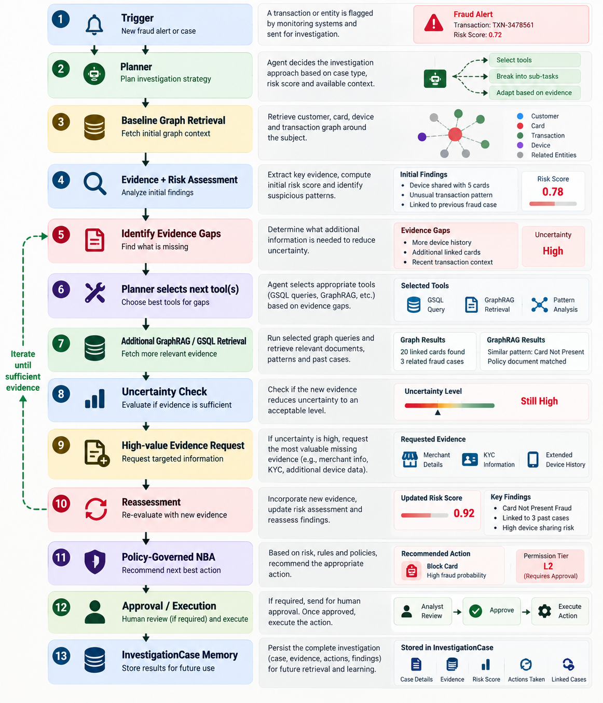

# Agentic Fraud Investigation Platform

> An autonomous, evidence-grounded, policy-controlled fraud investigation platform powered by TigerGraph GraphRAG, calibrated Bayesian risk scoring, and human-in-the-loop governance.

<p align="center">
  <a href="https://www.python.org/"></a>
  <a href="https://fastapi.tiangolo.com/"></a>
  <a href="https://www.tigergraph.com/"></a>
  <a href="./docs/TECHNICAL_VALIDATION.md"></a>
  <a href="./artifacts/benchmark/benchmark_report.md"></a>
  <a href="./LICENSE"></a>
  <a href="./docs/DEMO.md"></a>
</p>

---

## Table of Contents

1. [Problem Statement](#1-problem-statement)
2. [Solution Overview](#2-solution-overview)
3. [Key Capabilities](#3-key-capabilities)
4. [Architecture](#4-architecture)
5. [Agentic Workflow](#5-agentic-workflow)
6. [Technology Stack](#6-technology-stack)
7. [Repository Structure](#7-repository-structure)
8. [Requirements](#8-requirements)
9. [Installation](#9-installation)
10. [Environment Configuration](#10-environment-configuration)
11. [Running Locally](#11-running-locally)
12. [TigerGraph Setup & Configuration](#12-tigergraph-setup--configuration)
13. [API Overview](#13-api-overview)
14. [Investigation Workflow](#14-investigation-workflow)
15. [Testing & Validation](#15-testing--validation)
16. [Security Considerations](#16-security-considerations)
17. [Configuration Options](#17-configuration-options)
18. [Limitations](#18-limitations)
19. [Future Improvements](#19-future-improvements)
20. [License](#20-license)

---

## 1. Problem Statement

Financial fraud detection systems in banks and payment processors face three fundamental operational bottlenecks:

1. **Black-Box Score Opacity**: Machine learning models produce risk scores (e.g., `0.87`) without transparent, verifiable explanations. Fraud analysts cannot immediately see *why* an alert triggered or what underlying graph connections justify blocking a card or declining a transaction.
2. **Investigation Fatigue & High False Positives**: Analysts manually query multiple disjoint systems—card records, device fingerprints, transaction logs, merchant histories, and previous dispute records—to build context. This manual multi-hop correlation creates investigation latency and inconsistent decisions.
3. **Absence of Governed Action Enactment**: Alerts are frequently disconnected from institutional banking policy. Without deterministic policy gating, recommended actions risk either unauthorized auto-execution (causing customer friction) or delayed intervention (causing financial exposure).

---

## 2. Solution Overview

The **Agentic Fraud Investigation Platform** converts raw transactional fraud alerts into complete, auditable, and policy-governed investigations:

$$\text{Alert} \longrightarrow \text{Graph Evidence} \longrightarrow \text{Pattern Reasoning} \longrightarrow \text{Risk Decomposition} \longrightarrow \text{Uncertainty Loop} \longrightarrow \text{Governed NBA} \longrightarrow \text{Human Approval} \longrightarrow \text{Graph Case Memory}$$

The platform integrates:
- **TigerGraph Savanna Cloud / GSQL Engine**: High-performance multi-hop graph traversal that links customers, cards, transactions, device profiles, and billing regions.
- **GraphRAG Evidence Retrieval**: Contextual retrieval across previous investigation cases, fraud rings, and institutional banking policies.
- **Adaptive Agent Planner**: An autonomous orchestrator that dynamically selects investigation tools based on open evidence gaps rather than executing a hardcoded sequence.
- **Explainable Noisy-OR Risk Modeling**: Calibrated Bayesian odds aggregation across independent evidence channels (device sharing, velocity bursts, historical dispute records, customer responses).
- **Human-in-the-Loop (HITL) Governance**: Strict role separation (Auto-Execution, Level 1 Team Lead, Level 2 Operations Manager) with immutable SQLite audit logging.
- **Closed-Loop Graph Memory**: Every completed investigation is written back to TigerGraph as an `InvestigationCase` vertex, allowing future investigations to leverage prior findings.

---

## 3. Key Capabilities

### Live Graph Traversal & Topology Analysis
- **Multi-Hop Traversal**: Discovers shared devices, card networks, and account clusters across hundreds of thousands of transactions.
- **Fraud-Ring Component Detection**: Analyzes connected graph components to detect organized fraud rings and syndicated card testing.
- **Strict Backend Mode**: Enforces fail-closed operation (`STRICT_GRAPH_BACKEND=1`), ensuring production environments never silently fall back to mock data if the authoritative database is unavailable.

### Provenance-Aware Evidence Assembly
Every evidence item is cataloged with an immutable evidence identifier, claim classification, and query reference:
- `OBSERVED FACT`: Directly queried graph properties (e.g., historical transaction count, device profile matches).
- `DERIVED INFERENCE`: Algorithmic conclusions (e.g., velocity anomalies, fraud ring membership).
- `MODEL SCORE`: Upstream detection model inputs.

### Active Uncertainty & Evidence-Gap Reduction
- Evaluates expected information value ($0.0 - 1.0$) for potential follow-up inquiries.
- Determines whether gathering additional evidence (customer confirmation, step-up authentication, merchant records) could change the recommended action.
- Supports both `human_in_loop` (agent pauses at `MORE_EVIDENCE_REQUIRED` waiting for analyst input) and `simulated` (generates transparent, audit-marked synthetic responses).

### Policy-Governed Next Best Action (NBA)
- Deterministic rules engine enforcing institutional banking policies (§3 R1–R11).
- Generates concrete remediation recommendations: `BLOCK_CARD`, `DECLINE_TRANSACTION`, `FILE_REPORT` (SAR), `MONITOR_CONNECTED_CARDS`, `REQUEST_CUSTOMER_CONFIRMATION`, and `CLOSE_NO_FRAUD`.
- Documents policy citations, current state justifications, and evaluated alternatives.

### Analyst Command Center
- **Interactive Knowledge Graph Canvas**: HTML5 canvas rendering subgraphs with force-directed physics, node clustering, and entity inspectors.
- **Visual Causal Journey**: 11-stage progress tracker illustrating trigger ingestion, planning, evidence collection, risk reassessment, and action approval.
- **Regulatory SAR Generator**: Prepares Suspicious Activity Report (SAR) narratives citing timestamped evidence, exposure totals, and subject cards/devices.

---

## 4. Architecture

The system consists of five decoupled layers designed for modularity, observability, and testability:

```
┌────────────────────────────────────────────────────────────────────────┐
│                   Analyst Command Center (Web UI)                      │
│        Case Dossier • Dynamic Graph Canvas • Risk Breakdown • SAR      │
└───────────────────────────────────┬────────────────────────────────────┘
                                    │ HTTP REST / JSON
┌───────────────────────────────────▼────────────────────────────────────┐
│                       FastAPI Application Gateway                      │
│        /investigations • /evidence • /approvals • /graph • /health     │
└───────────────────────────────────┬────────────────────────────────────┘
                                    │
┌───────────────────────────────────▼────────────────────────────────────┐
│                       Agentic Investigation Engine                     │
│  ┌──────────────┐   ┌────────────────┐   ┌──────────────────────────┐  │
│  │   Planner    │──▶│ Query Router   │──▶│ Pattern Reasoning        │  │
│  └──────────────┘   └────────────────┘   └──────────────────────────┘  │
│         │                   │                         │                │
│         ▼                   ▼                         ▼                │
│  ┌──────────────┐   ┌────────────────┐   ┌──────────────────────────┐  │
│  │ Evidence Gap │   │ Noisy-OR Risk  │   │ Policy Engine (NBA)      │  │
│  └──────────────┘   └────────────────┘   └──────────────────────────┘  │
└───────────────────────┬───────────────────────────────┬────────────────┘
                        │                               │
┌───────────────────────▼──────────────┐ ┌──────────────▼────────────────┐
│   TigerGraph Savanna Cloud / Local   │ │    SQLite Application State   │
│   Vertices: Customer, Card, Txn...   │ │    Investigations, Approvals, │
│   Edges: OWNS, MADE, FROM_DEVICE...  │ │    Idempotency, Audit Trail   │
└──────────────────────────────────────┘ └───────────────────────────────┘
```



---

## 5. Agentic Workflow

The autonomous investigation engine executes through an iterative, evidence-grounded state machine:



1. **Trigger Ingestion**: Receives an incoming alert (real-time transaction scoring anomaly or customer dispute report).
2. **Planner Strategy Selection**: Formulates an initial tool execution plan based on alert category and transaction attributes.
3. **Graph Traversal & GraphRAG Retrieval**: Executes GSQL queries against the graph database to retrieve customer history, card baseline statistics, device co-usage, and similar closed historical cases.
4. **Pattern Typology Classification**: Detects recognized fraud typologies (`card_not_present_fraud`, `card_not_present_new_device`, `account_takeover`, `card_testing`).
5. **Noisy-OR Risk Decomposition**: Aggregates independent risk channels into a calibrated composite fraud probability.
6. **Evidence Gap Identification**: Calculates residual uncertainty and scores potential evidence requests by decision impact.
7. **Reassessment Loop**: Incorporates additional evidence (e.g., customer verification) and updates Bayesian odds.
8. **Policy Engine Evaluation**: Validates facts against institutional policies to determine required actions and assign permission levels.
9. **Approval & Execution Routing**: Executes auto-approved actions immediately; enqueues high-impact actions (card blocks, SAR filings) for Level 1 or Level 2 human approval.
10. **Case Memory Persistence**: Creates an `InvestigationCase` vertex in the graph database to inform future anomaly detection.

---

## 6. Technology Stack

| Component | Technology | Rationale |
|---|---|---|
| **Backend API** | Python 3.11+, FastAPI, Pydantic v2 | High-performance asynchronous REST API with strict type validation |
| **Graph Database** | TigerGraph Savanna Cloud 4.x, GSQL | High-performance graph database optimized for deep multi-hop pattern analytics |
| **Graph Adapter** | pyTigerGraph, httpx | Connection pooling, token management, and REST API fallbacks |
| **State Persistence** | SQLite 3 | Embedded, durable relational store for application state and audit trails |
| **Frontend UI** | HTML5, CSS3, Vanilla ES6 JavaScript | Zero-build-step intelligence console with minimal footprint and maximum auditability |
| **Graph Visualization** | HTML5 Canvas API | High-performance physics-based graph layout without bulky heavy external dependencies |
| **Test Runner** | Pytest, pytest-asyncio, anyio | Comprehensive test suite covering unit, integration, and policy contracts |

---

## 7. Repository Structure

```
.
├── backend/                        # Backend Python service
│   ├── agents/                     # Agent implementations
│   │   ├── evidence_gap.py         # Evidence gap detection & info-value ranking
│   │   ├── orchestrator.py         # Multi-stage investigation coordinator
│   │   └── planner.py              # Adaptive tool-planning engine
│   ├── db/                         # SQLite application database & audit log
│   ├── evaluation/                 # Benchmark runners & answer validators
│   ├── graph/                      # Graph access layer
│   │   ├── local_store.py          # Prepared SQLite graph store (local/test)
│   │   ├── query_router.py         # Intelligent graph backend abstraction
│   │   └── tg_adapter.py           # TigerGraph Savanna Cloud adapter
│   ├── graphrag/                   # Context assembly & case-note search
│   ├── llm/                        # Optional narrative generation client
│   ├── models/                     # Pydantic data schemas
│   ├── policies/                   # Deterministic banking policy engine (§3 R1–R11)
│   ├── risk/                       # Bayesian Noisy-OR composite risk modeling
│   ├── scripts/                    # Schema deployment and preparation scripts
│   ├── config.py                   # Environment settings & configuration loading
│   ├── logging.py                  # Structured logging configuration
│   └── main.py                     # FastAPI application entrypoint
│
├── frontend/                       # Analyst Command Center (Single Page UI)
│   ├── css/
│   │   └── style.css               # Dark forest green & warm cream design system
│   ├── js/
│   │   ├── api.js                  # Frontend REST API client
│   │   ├── app.js                  # UI state management & event handlers
│   │   └── graph.js                # HTML5 canvas interactive knowledge graph
│   └── index.html                  # Main command center interface
│
├── tigergraph/                     # TigerGraph database assets
│   ├── gsql/                       # GSQL query & algorithm definitions
│   ├── loading/                    # Loading job scripts for tabular ingestion
│   └── schema/                     # DDL schema definitions & schema-change jobs
│
├── cases/                          # 20-case investigation benchmark definitions
├── tests/                          # Automated test suite (257 tests)
│   ├── integration/                # API, graph, policy, and agentic upgrade tests
│   └── unit/                       # Risk, policy, and evidence provenance tests
│
├── docs/                           # Documentation
│   ├── backend/                    # Architecture and dataset specifications
│   ├── images/                     # System architecture & flow diagrams
│   ├── ARCHITECTURE.md             # In-depth system architecture
│   ├── DEMO.md                     # Interactive demonstration walkthrough
│   └── TECHNICAL_VALIDATION.md     # Empirical validation and benchmark results
│
├── artifacts/                      # Benchmark reports and validation artifacts
├── scripts/                        # Administrative utilities
├── .env.example                    # Environment variable template
├── pyproject.toml                  # Python package configuration
├── requirements.txt                # Pinned production dependencies
└── README.md                       # Project documentation
```

---

## 8. Requirements

- **Operating System**: Linux, macOS, or Windows 10/11
- **Python**: Version `3.11` or higher
- **Browser**: Modern web browser (Chrome, Edge, Firefox, Brave)
- **TigerGraph** (Optional for local development; required for live graph mode):
  - TigerGraph Savanna Cloud or on-premises instance (version 4.x)
- **LLM API Key** (Optional):
  - Anthropic, OpenAI, or Groq API key for LLM summaries (the system defaults to deterministic template generation when not configured)

---

## 9. Installation

### 1. Clone the repository

```bash
git clone https://github.com/shaikmohammedyasin-create/HHGoa26-Agentic-Fraud-Investigation.git agentic-fraud-investigation
cd agentic-fraud-investigation
```

> ℹ️ **Repository Name Note:** The active GitHub repository URL is currently `https://github.com/shaikmohammedyasin-create/HHGoa26-Agentic-Fraud-Investigation.git`. To complete the project URL transition to `https://github.com/shaikmohammedyasin-create/agentic-fraud-investigation.git`, update the repository name in **GitHub Settings → General → Repository Name**.

### 2. Set up a virtual environment

**Linux / macOS:**
```bash
python3 -m venv .venv
source .venv/bin/activate
```

**Windows (PowerShell):**
```powershell
python -m venv .venv
.\.venv\Scripts\Activate.ps1
```

### 3. Install dependencies

```bash
pip install -r requirements.txt
```

---

## 10. Environment Configuration

Copy the example environment configuration:

```bash
cp .env.example .env
```

Edit `.env` to configure your execution mode:

```env
# Application Environment (development | benchmark | production)
APP_ENV=development
LOG_LEVEL=INFO

# Graph Backend (local | tigergraph)
GRAPH_BACKEND=local
STRICT_GRAPH_BACKEND=false

# TigerGraph Settings (required if GRAPH_BACKEND=tigergraph)
TG_HOST=https://your-instance.i.tgcloud.io
TG_GRAPH=fraud_investigation
TG_SECRET=your_tigergraph_secret
TG_PORT=443
TG_PROTOCOL=https

# Agentic Evidence Loop (simulated | human_in_loop)
EVIDENCE_REQUEST_MODE=simulated

# LLM Provider (anthropic | openai | groq | none)
LLM_PROVIDER=none
```

---

## 11. Running Locally

Start the FastAPI application with Uvicorn:

```bash
uvicorn backend.main:app --port 8000
```

For hot-reload during development:

```bash
uvicorn backend.main:app --reload --port 8000
```

Open your browser and navigate to:
```
http://localhost:8000
```

The Analyst Command Center will load with system connectivity diagnostics.

---

## 12. TigerGraph Setup & Configuration

To run against a live TigerGraph instance:

### 1. Deploy the Schema
Deploy vertex and edge definitions to the target graph (`fraud_investigation`):

```bash
python -m backend.scripts.deploy_schema
```

### 2. Compile GSQL Queries
Install and compile the parameterized queries:

```bash
python scripts/deploy_all_queries.py
```

Queries deployed include:
- `card_transaction_history`: 30-day transactional window for card baseline.
- `accounts_sharing_device`: Discovers cards that share hardware/browser fingerprints.
- `device_fraud_ring`: Traverses device co-usage components to detect organized syndicates.
- `closed_cases_by_device`: Retrieves historical confirmed fraud cases linked to a device.
- `insert_investigation_case`: Upserts completed case vertices into the knowledge graph.

---

## 13. API Overview

The backend exposes a structured, typed OpenAPI REST interface:

### System & Health
| Method | Endpoint | Description |
|---|---|---|
| `GET` | `/health` | Returns service health, graph connectivity, database state, and active configuration |

### Investigations
| Method | Endpoint | Description |
|---|---|---|
| `POST` | `/investigations` | Initiates an investigation for a designated case ID |
| `GET` | `/investigations` | Lists recorded investigations with pagination |
| `GET` | `/investigations/{case_id}` | Retrieves standardized investigation answer payload |
| `POST` | `/investigations/{case_id}/run` | Re-runs or resumes an investigation (`force=true` forces a clean rerun) |
| `GET` | `/api/investigations/{case_id}/full` | Retrieves rich investigation state including triggers, evidence cards, and policy decisions |
| `GET` | `/api/investigations/{case_id}/graph` | Generates a scoped subgraph JSON for the canvas visualization engine |
| `GET` | `/investigations/{case_id}/timeline` | Returns timestamped audit events for the investigation |

### Evidence & Human-in-the-Loop
| Method | Endpoint | Description |
|---|---|---|
| `GET` | `/investigations/{case_id}/evidence` | Lists evidence items assembled for the case |
| `POST` | `/investigations/{case_id}/evidence` | Submits human evidence to resolve a pending information request |

### Policy & Approvals
| Method | Endpoint | Description |
|---|---|---|
| `GET` | `/investigations/{case_id}/approvals` | Lists pending Level 1 / Level 2 actions requiring authorization |
| `POST` | `/investigations/{case_id}/approvals/{approval_id}` | Records approval or rejection under the analyst's identity |

### Evaluation & Benchmark
| Method | Endpoint | Description |
|---|---|---|
| `GET` | `/api/cases` | Lists available benchmark cases from the case pack |
| `POST` | `/benchmark/run` | Executes the full 20-case evaluation benchmark |
| `GET` | `/benchmark/report` | Returns latest benchmark summary statistics |
| `GET` | `/benchmark/checkpoints` | Returns structural checkpoint compliance metrics (600 checkpoints) |

---

## 14. Investigation Workflow

A typical investigation through the Command Center proceeds as follows:

```
[1. Select Case] ──▶ [2. Ingest Trigger] ──▶ [3. Run Agent Engine] ──▶ [4. Inspect Subgraph]
                                                                                │
[7. Persist Memory] ◀── [6. Authorize Action] ◀── [5. Reassess Risk] ◀──────────┘
```

1. **Select Dossier**: Choose an active case (e.g., `CASE-014` or `CASE-006`) from the Case Selector.
2. **Review Trigger Context**: View flagged transaction details, transaction amount, merchant channel, and upstream risk scores.
3. **Execute Live Investigation**: Click **Start Live Investigation** to trigger agent traversal.
4. **Inspect Graph Topology**: Use the interactive canvas to inspect nodes (Customer, Card, Transaction, DeviceProfile) and identify sharing links.
5. **Resolve Uncertainty**: If the case pauses at `MORE_EVIDENCE_REQUIRED`, navigate to the Uncertainty tab, review expected information value, and submit cardholder verification.
6. **Authorize Policy Actions**: Review recommended Next Best Actions. If an action requires L1 or L2 authorization, submit an approval or rejection.
7. **Verify Case Memory**: Inspect the generated SAR narrative and verify that the `InvestigationCase` vertex has been persisted to the graph database.

---

## 15. Testing & Validation

### Automated Test Suite

Run the full pytest suite (257 tests):

```bash
pytest
```

The test suite covers:
- **Unit Tests**: Bayesian Noisy-OR mathematics, pattern detectors, evidence provenance invariants, policy rule evaluations (§3 R1–R11), and Pydantic validation contracts.
- **Integration Tests**: FastAPI endpoint integration, SQLite idempotency, audit event logging, and human-in-the-loop approval state transitions.
- **Graph Backends**: Query router consistency across both SQLite and TigerGraph adapters.

### Structural Checkpoint Verification

To verify that all 20 benchmark investigation cases adhere to strict structural contracts:

```bash
python -m backend.evaluation.validate_answers
```

This validates 30 discrete checkpoints per case (600 total checkpoints) covering schema integrity, evidence citation consistency, SAR justification, and graph persistence.

---

## 16. Security Considerations

- **Credential Management**: All secrets (TigerGraph tokens, database credentials, API keys) are managed through environment variables. No secrets are committed to version control.
- **Fail-Closed Graph Mode**: In production environments, `STRICT_GRAPH_BACKEND=1` prevents silent data fabrication if the graph database encounters connectivity issues.
- **Human Authority Gating**: Critical financial actions (e.g., card blocks above policy exposure limits, filing regulatory reports) cannot auto-execute without explicit human approval recorded in the audit trail.
- **Audit Immutability**: All decisions, approver identities, timestamps, and evidence states are appended to an immutable SQLite audit log.
- **Synthetic Data Labeling**: Simulated responses in automated benchmark runs are explicitly stamped with `origin="simulated"` to maintain transparency.

---

## 17. Configuration Options

| Variable | Default | Description |
|---|---|---|
| `APP_ENV` | `development` | Operating profile: `development`, `benchmark`, `production` |
| `GRAPH_BACKEND` | `local` | Graph engine: `local` (SQLite store) or `tigergraph` (Savanna Cloud) |
| `STRICT_GRAPH_BACKEND` | `false` | When true, graph query errors raise exceptions rather than falling back |
| `TG_HOST` | `""` | Base URL for the TigerGraph Savanna Cloud cluster |
| `TG_GRAPH` | `fraud_investigation` | Name of target graph in TigerGraph |
| `TG_SECRET` | `""` | TigerGraph secret for REST API authentication |
| `TG_TOKEN` | `""` | Pre-generated TigerGraph auth token |
| `EVIDENCE_REQUEST_MODE` | `simulated` | `simulated` (automated benchmark) or `human_in_loop` (interactive UI pauses) |
| `MIN_EVIDENCE_INFO_VALUE`| `0.25` | Minimum expected information gain required to halt for evidence |
| `MAX_INVESTIGATION_STEPS`| `25` | Circuit breaker for agent tool traversal depth |
| `MAX_EVIDENCE_REQUESTS` | `3` | Maximum number of evidence inquiries per case |
| `FRAUD_PROB_STOP_HIGH` | `0.85` | High-confidence fraud threshold for early stopping |
| `FRAUD_PROB_STOP_LOW` | `0.15` | High-confidence legitimate threshold for early stopping |
| `LLM_PROVIDER` | `none` | LLM service for narrative formatting: `anthropic`, `openai`, `groq`, `none` |

---

## 18. Limitations

- **Single-Node Application State**: The SQLite application state store (`data/app/app.db`) is optimized for single-instance or edge deployment. Distributed horizontal scaling requires migrating state to PostgreSQL.
- **Browser-Based Canvas Rendering**: The HTML5 canvas graph visualizer is optimized for subgraphs up to ~1,500 nodes. Very large fraud ring visualizations (>5,000 nodes) should utilize WebGL rendering.
- **Historical Dataset Grounding**: The bundled historical transaction and dispute data is based on the IEEE-CIS Fraud Detection dataset benchmarks.

---

## 19. Future Improvements

- **Distributed State Store**: Migration of application state and audit trails to PostgreSQL with pgvector integration.
- **Real-Time Stream Ingestion**: Kafka / RabbitMQ consumer integration for sub-second event ingestion directly from payment gateways.
- **Enterprise SSO & RBAC**: Integration with OAuth2 / OIDC providers (Okta, Keycloak) to map corporate roles directly to L1/L2 approval tiers.
- **Graph Neural Network (GNN) Embeddings**: Native TigerGraph GNN integration to complement rule-based pattern typologies with unsupervised structural anomaly embeddings.

---

## 20. License

This project is licensed under the **MIT License** — see the [LICENSE](./LICENSE) file for complete details.

Copyright &copy; 2026 Agentic Fraud Investigation Platform Contributors. All rights reserved.
